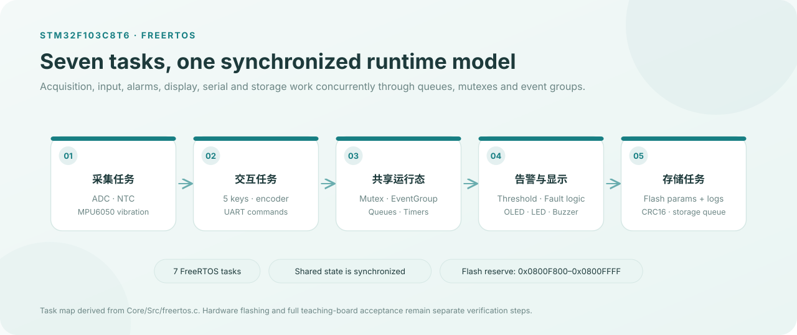

# FreeRTOS 智能环境监测与交互告警系统

基于 STM32F103C8T6、FreeRTOS 与 STM32 HAL 的嵌入式综合实验工程，使用 Keil MDK-ARM（uVision）开发和编译。

主要功能包括温度采集与滤波、OLED 显示和按键交互、温度及传感器异常告警、蜂鸣器与 LED 提示、串口命令、Flash 参数保存与报警日志，以及 MPU6050 振动检测选做功能。

## 系统架构

  

任务关系根据 Core/Src/freertos.c 整理；图示不替代 Keil 编译、开发板烧录和传感器实测验收。

## 打开工程

使用 Keil uVision 打开 `MDK-ARM/Freertos_Sys.uvprojx`。按工程配置安装 STM32F1xx Device Pack 和 Arm Compiler 5，然后执行 Rebuild。

## 验证说明

详细研发、编译和硬件验收记录见 [VERIFICATION.md](VERIFICATION.md)。记录中已注明：源码与 Keil 重建曾通过，但尚未完成真实教学板烧录和全部硬件验收。请以实际复测结果为准。

烧录前应备份 STM32 内部 Flash 保留区 `0x0800F800–0x0800FFFF`，避免覆盖设备参数和历史日志。
